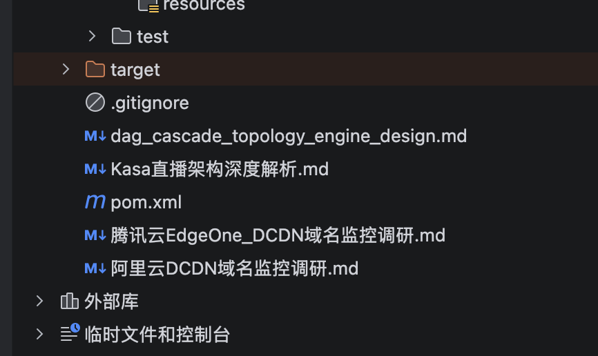

# DAG 级联拓扑引擎 — 实体删除与恢复技术方案

> 将级联删除/恢复逻辑从 miline_service 硬编码下沉到 miline_entity 层，通过声明式 DSL + DAG 拓扑引擎实现通用级联删除与恢复。

---

## 一、现状分析与问题

### 1.1 当前架构

```
miline_openapi
  └─ miline_service（业务编排层）
       ├─ batchGetStoryTree → 遍历需求树
       ├─ fetchChildrenCodes → DFS 收集子需求/子任务
       ├─ saveDeletedRelates → Mongo delete_relate（供撤销用）
       ├─ BatchDeleteTask → entity_rpc.BatchDeleteEntities
       └─ BatchDeleteStory → entity_rpc.BatchDeleteEntities
            └─ miline_entity（实体存储层）
                 ├─ Mongo 软删（deleted: true）
                 ├─ 反向字段写 Redis → 清空反向字段 → 删 entity_relation
                 ├─ ES 软删（deleted: true）
                 ├─ GDB 软删（deleted: true）
                 └─ 领域事件
```

### 1.2 核心问题

| # | 问题 | 影响 |
|---|------|------|
| 1 | **三层临时缓存导致恢复数据丢失** | Redis 反向字段缓存 + Mongo delete_relate + Redis entity_relation（MySQL 路径），三处各自独立过期，任一过期即无法完整恢复 |
| 2 | **级联逻辑硬编码在 miline_service** | Story 删除要遍历需求树 → 收集子需求/子任务 → 逐个类型调 entity RPC；每种 SubjectType 都要写一套 |
| 3 | **级联覆盖不完整** | ❌ 删需求时，评论（Note）不删；❌ 删需求时，审阅版本（ReviewVersion）不删；❌ 删审阅版本时，评论不删；❌ 删任务时，评论不删 |
| 4 | **新类型接入成本高** | 新增 SubjectType 需在 service 层写完整级联逻辑，无法复用 |
| 5 | **恢复信息与实体生命周期不一致** | 软删实体还在，但恢复信息（Redis/Mongo 缓存）可能已过期 |

### 1.3 现有级联覆盖矩阵（改造前 vs 改造后）

| 场景 | 当前是否级联 | 改造后 |
|------|:-----------:|:------:|
| 删 Story → 子 Story | ✅ | ✅ |
| 删 Story → 子 Task | ✅ | ✅ |
| 删 Story → 评论（Note） | ❌ | ✅ |
| 删 Story → 审阅版本（ReviewVersion） | ❌ | ✅ |
| 删 Task → 评论（Note） | ❌ | ✅ |
| 删 ReviewVersion → 评论（Note） | ❌ | ✅ |
| 恢复 Story → 子 Story + 子 Task | ✅（基于缓存） | ✅（基于 snapshot） |
| 恢复 Story → 评论 | ❌ | ✅ |
| 恢复 Story → 审阅版本 + 其评论 | ❌ | ✅ |
| 恢复 Task → 评论 | ❌ | ✅ |

---

## 二、设计目标

| 目标 | 描述 |
|------|------|
| **恢复信息与软删除数据同生命周期** | snapshot 与 entity 软删数据同库同过期，只要 entity 没被物理删除，就一定能完整恢复 |
| **级联删除/恢复下沉到 entity 层** | 服务层只定义级联策略（DSL），entity 层执行 |
| **DAG 拓扑引擎** | 级联关系是有向无环图（DAG），引擎按拓扑序执行，支持多层异构级联 |
| **扩展性** | 新 SubjectType 只需定义 DSL 策略，entity 层零改动 |
| **恢复完全基于 snapshot** | 恢复时不做任何外部查询，完全基于删除时保存的 snapshot |

---

## 三、整体架构

### 3.1 新架构总览

```
┌──────────────────────────────────────────────────────────┐
│                   miline_service（服务层）                  │
│                                                          │
│  ┌────────────────────────────────────────────────────┐  │
│  │           Cascade DSL Registry（策略注册）            │  │
│  │                                                    │  │
│  │   StoryCascadeDSL    TaskCascadeDSL    ...         │  │
│  │   nodes + deps       nodes + deps                  │  │
│  └────────────────────────────────────────────────────┘  │
│                          │                               │
│              CascadeDeleteEntities RPC                   │
│              CascadeRestoreEntities RPC                  │
│                          │                               │
└──────────────────────────┼───────────────────────────────┘
                           │  cascade_topology DSL
                           ▼
┌──────────────────────────────────────────────────────────┐
│                   miline_entity（实体层）                   │
│                                                          │
│  ┌────────────────────────────────────────────────────┐  │
│  │             DAG Cascade Topology Engine             │  │
│  │                                                    │  │
│  │  Parse DSL → Build DAG → Topo Sort → Layer Execute │  │
│  │                                                    │  │
│  │  ┌──────────────┐  ┌──────────────┐  ┌──────────┐ │  │
│  │  │RelationLookup│  │ FieldLookup  │  │RemoteField│ │  │
│  │  │   (GDB)      │  │  (MongoDB)   │  │ Lookup(ES)│ │  │
│  │  └──────────────┘  └──────────────┘  └──────────┘ │  │
│  └────────────────────────────────────────────────────┘  │
│                          │                               │
│         ┌────────────────┼────────────────┐              │
│         ▼                ▼                ▼              │
│   Mongo 软删       Snapshot 写入      GDB/ES 软删        │
│   (同一库同生命周期)  (同一库同生命周期)                     │
└──────────────────────────────────────────────────────────┘
```

### 3.2 调用时序（删除）

```
miline_service                         miline_entity
     │                                      │
     │  CascadeDeleteEntities               │
     │  { root_codes, cascade_topology }    │
     │─────────────────────────────────────>│
     │                                      │
     │                              ┌───────┴───────┐
     │                              │ Parse DSL     │
     │                              │ Build DAG     │
     │                              │ Topo Sort     │
     │                              └───────┬───────┘
     │                                      │
     │                              ┌───────┴───────┐
     │                              │ Layer 0: Root │
     │                              │  查找直接子节点 │
     │                              └───────┬───────┘
     │                                      │
     │                              ┌───────┴───────┐
     │                              │ Layer 1: 子节点│
     │                              │  查找孙节点    │
     │                              └───────┬───────┘
     │                                      │
     │                              ┌───────┴───────┐
     │                              │ Layer N: 叶子  │
     │                              └───────┬───────┘
     │                                      │
     │                              ┌───────┴───────┐
     │                              │ Save Snapshot │
     │                              │ (每实体一条)   │
     │                              └───────┬───────┘
     │                                      │
     │                              ┌───────┴───────┐
     │                              │ Execute Delete│
     │                              │ 按拓扑逆序:    │
     │                              │ 叶子→...→根    │
     │                              └───────┬───────┘
     │                                      │
     │  { op_id, deleted_codes }             │
     │<─────────────────────────────────────│
```

---

## 四、DSL 设计 — 级联拓扑声明

### 4.1 DSL 结构定义

采用标准 DAG 定义方式：**nodes（顶点）+ deps（有向边）**。

```protobuf
// proto/api/miline_entity/cascade.proto

message CascadeTopology {
  repeated CascadeNode nodes = 1;  // DAG 顶点
  repeated CascadeDep  deps  = 2;  // DAG 有向边
}

message CascadeNode {
  string node_id = 1;              // 节点唯一标识，如 "children", "comments"
  LookupStrategy strategy = 2;     // 查找策略
}

message CascadeDep {
  string from = 1;  // 上游节点 node_id（"__root__" 表示入口实体）
  string to   = 2;  // 下游节点 node_id
}

// 查找策略：三种方式
message LookupStrategy {
  oneof lookup {
    RelationLookup    relation_lookup     = 1;  // 沿 GDB 关系边查拓扑
    FieldLookup       field_lookup        = 2;  // 读自身字段值获取引用 codes
    RemoteFieldLookup remote_field_lookup = 3;  // 搜"谁的字段引用了我"
  }
}

// 策略一：RelationLookup — 沿 GDB 关系边，与 GetEntityRelationTopology 参数一致
message RelationLookup {
  string relation_key = 1;  // GDB 边 label，如 "parent_child"
  string direction    = 2;  // "out" | "in" | "both"
  int32  max_depth    = 3;  // 最大遍历深度，0=不限
}

// 策略二：FieldLookup — 读自身字段值，获取引用的实体 codes
message FieldLookup {
  string field_key = 1;     // 字段 key，如 "refer_entity_code"
}

// 策略三：RemoteFieldLookup — 搜"谁的字段引用了我"
message RemoteFieldLookup {
  string target_field_key       = 1;  // 目标实体的字段 key，如 "object_key"
  string target_entity_type_key = 2;  // 目标实体类型 key，如 "mi_note"
  int32  subject_type           = 3;  // 目标实体的 SubjectType
}
```

### 4.2 nodes + deps 设计优势

| 优势 | 说明 |
|------|------|
| **节点复用** | 同一种查找（如 comments）只需定义一次，通过 deps 被多个上游节点复用 |
| **关系清晰** | nodes 是顶点，deps 是有向边，符合 DAG 标准定义 |
| **易于扩展** | 新增节点或依赖关系时，不影响已有节点定义 |
| **声明式** | 服务层只描述"什么关系"，不关心"怎么执行" |

### 4.3 具体 DSL 示例

#### Story 删除级联 DSL

> 子需求和子任务统一为 `children`（GDB parent_child 不区分 SubjectType，统一遍历所有后代）。
> 审阅版本的评论和其他评论统一为 `comments`（都是通过 ES 查 mi_note.object_key）。

```
DAG（3 个节点 + 6 条边）:

  __root__ ──→ children ──→ review_versions ──→ comments
     │            │                              ↑
     │            └──→ comments (复用) ───────────┘
     │
     ├──→ review_versions (复用，见上)
     │
     └──→ comments (复用，见上)

拓扑分层（Kahn 算法）:

  入度: children=1, review_versions=2, comments=3
  Layer 0:  __root__
  Layer 1:  children
  Layer 2:  review_versions
  Layer 3:  comments
```

```go
// miline_service/domain/story_service/cascade_dsl.go

func BuildStoryCascadeTopology() *miline_entity.CascadeTopology {
    return &miline_entity.CascadeTopology{
        Nodes: []*miline_entity.CascadeNode{
            {
                NodeId: "children",
                Strategy: &miline_entity.LookupStrategy{
                    Lookup: &miline_entity.LookupStrategy_RelationLookup{
                        RelationLookup: &miline_entity.RelationLookup{
                            RelationKey: "parent_child",
                            Direction:   "out",
                            MaxDepth:    0, // 不限深度，GDB 递归遍历所有后代
                        },
                    },
                },
            },
            {
                NodeId: "review_versions",
                Strategy: &miline_entity.LookupStrategy{
                    Lookup: &miline_entity.LookupStrategy_RemoteFieldLookup{
                        RemoteFieldLookup: &miline_entity.RemoteFieldLookup{
                            TargetFieldKey:      "refer_entity_code",
                            TargetEntityTypeKey: "mi_review_version",
                            SubjectType:         100, // NORMAL
                        },
                    },
                },
            },
            {
                NodeId: "comments",
                Strategy: &miline_entity.LookupStrategy{
                    Lookup: &miline_entity.LookupStrategy_RemoteFieldLookup{
                        RemoteFieldLookup: &miline_entity.RemoteFieldLookup{
                            TargetFieldKey:      "object_key",
                            TargetEntityTypeKey: "mi_note",
                            SubjectType:         100, // NORMAL
                        },
                    },
                },
            },
        },
        Deps: []*miline_entity.CascadeDep{
            {From: "__root__", To: "children"},
            {From: "__root__", To: "review_versions"},
            {From: "__root__", To: "comments"},
            {From: "children", To: "review_versions"},
            {From: "children", To: "comments"},
            {From: "review_versions", To: "comments"},
        },
    }
}
```

> `children` 节点的 GDB 查询一次性返回所有层级的后代（子需求 + 子任务），
> 引擎在构建拓扑树时通过 `CodesByParent` 逐层自展开还原出树形结构。

#### Task 删除级联 DSL

```go
func BuildTaskCascadeTopology() *miline_entity.CascadeTopology {
    return &miline_entity.CascadeTopology{
        Nodes: []*miline_entity.CascadeNode{
            {
                NodeId: "comments",
                Strategy: &miline_entity.LookupStrategy{
                    Lookup: &miline_entity.LookupStrategy_RemoteFieldLookup{
                        RemoteFieldLookup: &miline_entity.RemoteFieldLookup{
                            TargetFieldKey:      "object_key",
                            TargetEntityTypeKey: "mi_note",
                            SubjectType:         100,
                        },
                    },
                },
            },
        },
        Deps: []*miline_entity.CascadeDep{
            {From: "__root__", To: "comments"},
        },
    }
}
```

#### ReviewVersion 删除级联 DSL

```go
func BuildReviewVersionCascadeTopology() *miline_entity.CascadeTopology {
    return &miline_entity.CascadeTopology{
        Nodes: []*miline_entity.CascadeNode{
            {
                NodeId: "comments",
                Strategy: &miline_entity.LookupStrategy{
                    Lookup: &miline_entity.LookupStrategy_RemoteFieldLookup{
                        RemoteFieldLookup: &miline_entity.RemoteFieldLookup{
                            TargetFieldKey:      "object_key",
                            TargetEntityTypeKey: "mi_note",
                            SubjectType:         100,
                        },
                    },
                },
            },
        },
        Deps: []*miline_entity.CascadeDep{
            {From: "__root__", To: "comments"},
        },
    }
}
```

---

## 五、DAG 拓扑引擎设计（miline_entity 层）

### 5.1 引擎核心流程

```
CascadeDeleteEntities(root_codes, cascade_topology)
  │
  ├─ 1. Parse DSL：解析 nodes/deps，构建邻接表
  │
  ├─ 2. Validate DAG：检测环路（Kahn 算法副产物）
  │
  ├─ 3. Topo Sort：Kahn 算法拓扑排序，生成分层调度计划
  │     （以 Story DSL 为例）
  │     入度: children=1, review_versions=2, comments=3
  │     Layer 0: [__root__]
  │     Layer 1: [children]
  │     Layer 2: [review_versions]
  │     Layer 3: [comments]
  │     关键：每个 DAG 节点只执行一次，输入是所有上游节点输出的并集
  │
  ├─ 4. Layer Execute（分层查找）：
  │     for each layer:
  │       for each node in layer:
  │         input_codes = union(all parent nodes' output_codes)
  │         output_codes = execute_lookup(node.strategy, input_codes)
  │         merge into topology_result
  │
  ├─ 5. Build Complete Topology：
  │     all_codes = flatten(topology_result)  // 所有需要删除的 entity codes
  │     dedup(all_codes)
  │
  ├─ 6. Save Snapshot（每实体一条）：
  │     op_id = uuid()
  │     根实体: delete_action=DIRECT_DELETE, cascade_info.cascade_topology=拓扑树
  │     级联实体: delete_action=CASCADE_DELETE, cascade_info.source_root=根实体code
  │     写入 MongoDB c_entity_delete_snapshot 集合
  │
  └─ 7. Execute Delete（按拓扑逆序：叶子 → 根）：
        for layer in reversed(layers):
          batch_soft_delete(layer_codes)  // Mongo + GDB + ES
```

### 5.2 引擎代码结构

```
miline_entity/
  domain/entity/service/cascade/
    ├── engine.go          // DAG 引擎入口
    ├── dag.go             // DAG 构建与拓扑排序
    ├── executor.go        // 分层执行器 + 拓扑树构建
    ├── snapshot.go        // 快照读写
    ├── lookup/
    │   ├── interface.go   // LookupExecutor 接口
    │   ├── relation.go    // RelationLookup（GDB）
    │   ├── field.go       // FieldLookup（MongoDB）
    │   └── remote_field.go // RemoteFieldLookup（ES）
    └── restore/
        ├── restore.go     // 恢复入口
        └── strategy.go    // 恢复策略
```

### 5.3 Lookup 接口

所有策略统一返回 `LookupResult = map[string][]string`（parent_code → child_codes）。

```go
type LookupResult map[string][]string
```

- **RelationLookup (GDB)**：Gremlin `path()` 解析直接父子：`path[len-2]` = 直接父, `path[len-1]` = 子
- **FieldLookup (MongoDB)**：读实体字段值，parent = 实体 code，children = 字段引用 codes
- **RemoteFieldLookup (ES)**：`_source` 包含 `target_field_key`，从结果提取归属

### 5.4 分层执行器

```go
func (e *LayerExecutor) ExecuteLookup(ctx context.Context,
    rootCodes []string, layers [][]string) (*TopologyResult, error) {
    e.nodeOutputs["__root__"] = rootCodes
    for _, layer := range layers {
        // 同层并行执行
        for _, nodeId := range layer {
            inputCodes := collectUpstreamOutputs(e.dag, e.nodeOutputs, nodeId)
            lookupResult := execute(ctx, inputCodes, node.Strategy)
            e.nodeResults[nodeId] = lookupResult
            e.nodeOutputs[nodeId] = flattenValues(lookupResult)
        }
    }
    return e.buildTopologyResult(rootCodes), nil
}
```

### 5.5 拓扑树构建 — 多根隔离 + 多层 RelationLookup 自展开

```go
// 每个根独立构建拓扑树
func (e *LayerExecutor) buildTopologyResult(rootCodes []string) *TopologyResult {
    for _, rootCode := range rootCodes {
        edges := e.buildEdgesFiltered("__root__", set{rootCode})
        result.RootTopologies[rootCode] = &CascadeTopology{ Edges: edges }
    }
    return result
}

// 核心递归：parentCodes 逐层向下传递，确保多根隔离
func (e *LayerExecutor) buildEdgesFiltered(
    parentNodeId string, parentCodes set,
) []*TopologyEdge {
    var edges []*TopologyEdge
    for _, childNodeId := range e.dag.AdjList[parentNodeId] {
        result := filterByParent(e.nodeResults[childNodeId], parentCodes)
        if len(result) == 0 { continue }
        nextCodes := allChildCodes(result)

        var childEdges []*TopologyEdge
        // 多层 RelationLookup 自展开（children 节点 GDB 一次查出所有层级后代）
        if isMultiLevelRelation(e.dag.Nodes[childNodeId]) {
            childEdges = e.expandRelationLevels(childNodeId, nextCodes)
        }
        childEdges = append(childEdges, e.buildEdgesFiltered(childNodeId, nextCodes)...)

        edges = append(edges, &TopologyEdge{
            EdgeName: childNodeId, CodesByParent: result, Children: childEdges,
        })
    }
    return edges
}

// 多层自展开：递归过滤同一节点的更深层级
func (e *LayerExecutor) expandRelationLevels(nodeId string, parentCodes set) []*TopologyEdge {
    result := filterByParent(e.nodeResults[nodeId], parentCodes)
    if len(result) == 0 { return nil }
    nextCodes := allChildCodes(result)

    var childEdges []*TopologyEdge
    childEdges = append(childEdges, e.expandRelationLevels(nodeId, nextCodes)...)
    childEdges = append(childEdges, e.buildEdgesFiltered(nodeId, nextCodes)...)

    return []*TopologyEdge{{
        EdgeName: nodeId, CodesByParent: result, Children: childEdges,
    }}
}
```

> **`expandRelationLevels` 的作用**：`children` 节点的 GDB 一次返回所有层级后代
> （如 `{"STORY-A":["STORY-B","TASK-3"], "STORY-B":["TASK-1","TASK-2"]}`），
> 但拓扑树需要还原嵌套层级。此函数递归过滤同一个 `nodeResults`，
> 把 TASK-1/TASK-2 嵌套到 STORY-B 下，而不是平铺在最外层。

---

## 六、Snapshot 设计 — 每实体一条记录，只存恢复必需数据

### 6.1 核心思考

软删除只是标记 `deleted: true`，实体文档完整保留在 MongoDB 中。恢复只需翻转标志位 + 重建被删除过程中销毁的关系数据（反向字段 + entity_relation）。

### 6.2 c_entity_delete_snapshot 集合

```go
type EntityDeleteSnapshot struct {
    EntityCode   string        `bson:"entity_code"`    // 主键（唯一）
    OpId         string        `bson:"op_id"`          // 同批操作共享
    SubjectType  int32         `bson:"subject_type"`
    EntityTypeId int64         `bson:"entity_type_id"`
    EntityName   string        `bson:"entity_name"`
    DeleteAction DeleteAction  `bson:"delete_action"`  // DIRECT_DELETE / CASCADE_DELETE

    // ---- 恢复用 ----
    ReverseFields      []*FieldValueSnapshot `bson:"reverse_fields,omitempty"`
    DeletedRelationIDs []int64               `bson:"deleted_relation_ids,omitempty"`

    // ---- 操作信息 ----
    DeletedAt time.Time `bson:"deleted_at"`
    DeletedBy string    `bson:"deleted_by"`

    // ---- 级联信息（根实体有拓扑，非根实体指向根）----
    CascadeInfo *CascadeInfo `bson:"cascade_info"`
}

type CascadeInfo struct {
    SourceRoot      string           `bson:"source_root,omitempty"`       // 非根实体：指向根 code
    CascadeTopology *CascadeTopology `bson:"cascade_topology,omitempty"` // 根实体：完整拓扑树
}

type DeleteAction int32
const (
    DIRECT_DELETE  DeleteAction = 0  // 自身删除（用户直接请求删除的根实体）
    CASCADE_DELETE DeleteAction = 1  // 级联删除（因根实体被删而跟随删除）
)

type FieldValueSnapshot struct {
    FieldId  int64    `bson:"field_id"`
    FieldKey string   `bson:"field_key"`
    Values   []string `bson:"values"`
}
```

**`DeleteAction` 两种类型**：

| 类型 | 适用对象 | 说明 |
|------|---------|------|
| `DIRECT_DELETE` | 根实体 | 用户直接请求删除，`CascadeInfo.CascadeTopology` 有值 |
| `CASCADE_DELETE` | 级联实体 | 因根被删而跟随删除，`CascadeInfo.SourceRoot` 指向根 |

**`CascadeInfo` 的设计意义**：

```
根实体 STORY-A:
  cascade_info: { cascade_topology: { edges: [...] } }  // 有完整拓扑树

级联实体 TASK-1:
  cascade_info: { source_root: "STORY-A" }              // 指向根

从中间节点（如 TASK-1）查找根的拓扑：
  → 读 TASK-1.cascade_info.source_root = "STORY-A"
  → 读 STORY-A.cascade_info.cascade_topology = 完整拓扑树
```

### 6.3 CascadeTopology 与 TopologyEdge

```go
type CascadeTopology struct {
    DSLVersion    string          `bson:"dsl_version"`
    TotalAffected int             `bson:"total_affected"`
    Status        OperationStatus `bson:"status"`
    Edges         []*TopologyEdge `bson:"edges"`
}

type TopologyEdge struct {
    EdgeName      string              `bson:"edge_name"`
    CodesByParent map[string][]string `bson:"codes_by_parent"`
    Children      []*TopologyEdge     `bson:"children,omitempty"`
}

type OperationStatus int32
const (
    OPERATION_DELETED            OperationStatus = 0
    OPERATION_PARTIALLY_RESTORED OperationStatus = 1
    OPERATION_RESTORED           OperationStatus = 2
)
```

### 6.4 MongoDB 索引

```
集合: c_entity_delete_snapshot
索引:
  - { entity_code: 1 }                           // 唯一索引
  - { op_id: 1 }                                 // 按操作批次查
  - { "cascade_info.source_root": 1, op_id: 1 }  // 从中间节点查根
  - { deleted_at: -1 }                           // 回收站列表
```

---

## 七、删除流程 — 完整示例

### 7.1 API 定义

```protobuf
message CascadeDeleteEntitiesReq {
  repeated string root_entity_codes = 1;  // 根实体 codes
  CascadeTopology cascade_topology  = 2;  // 级联拓扑 DSL
}

message CascadeDeleteEntitiesResp {
  string op_id                          = 1;  // 操作批次 ID
  repeated string deleted_entity_codes  = 2;  // 所有被删除的 codes
  DisplayTopologyTree topology_tree     = 3;  // 展示用拓扑树（转换后）
}

// 展示用拓扑树（从内部 CascadeTopology 转换而来，清晰易读）
message DisplayTopologyTree {
  repeated DisplayNode roots = 1;
}

message DisplayNode {
  string entity_code   = 1;
  string entity_name   = 2;
  int32  subject_type  = 3;
  repeated DisplayNode children = 4;  // 递归子节点
}
```

> `DisplayTopologyTree` 是从内部存储的 `CascadeTopology`（CodesByParent 结构）转换而来的展示树，
> 把 edge 维度打平为纯实体父子维度，方便前端展示。

### 7.2 完整示例：删除 STORY-A

```
需求树:
  STORY-A
  ├── STORY-B
  │   ├── TASK-1 (评论: NOTE-3)
  │   └── TASK-2
  ├── STORY-C (评论: NOTE-2)
  ├── TASK-3
  ├── NOTE-1 (STORY-A 自身评论)
  └── RV-1 (STORY-A 的审阅版本, 评论: NOTE-4)
```

#### Step 1-2: Parse DSL & Build DAG

```
DAG 邻接表:
  __root__          → [children, review_versions, comments]
  children          → [review_versions, comments]
  review_versions   → [comments]
  comments          → []

入度:
  __root__          = 0
  children          = 1  (← __root__)
  review_versions   = 2  (← __root__, ← children)
  comments          = 3  (← __root__, ← children, ← review_versions)
```

#### Step 3: Topo Sort

```
Round 1: 处理 [__root__]
  children: 1→0 ✓, review_versions: 2→1, comments: 3→2
  → Layer 0 = [__root__]

Round 2: 处理 [children]
  review_versions: 1→0 ✓, comments: 2→1
  → Layer 1 = [children]

Round 3: 处理 [review_versions]
  comments: 1→0 ✓
  → Layer 2 = [review_versions]

Round 4: 处理 [comments]
  无后继
  → Layer 3 = [comments]

layers = [[__root__], [children], [review_versions], [comments]]
```

#### Step 4: Layer Execute

```
初始: nodeOutputs = { "__root__": ["STORY-A"] }
```

**Layer 1: children**

```
input = ["STORY-A"]
GDB: g.V('STORY-A').repeat(out('parent_child').has('deleted',false)).emit().path().by('entity_code')
返回路径:
  ["STORY-A","STORY-B"]
  ["STORY-A","STORY-B","TASK-1"]
  ["STORY-A","STORY-B","TASK-2"]
  ["STORY-A","STORY-C"]
  ["STORY-A","TASK-3"]

解析直接父子（path[len-2] → path[len-1]）:
  nodeResults["children"] = {
    "STORY-A": ["STORY-B", "STORY-C", "TASK-3"],
    "STORY-B": ["TASK-1", "TASK-2"]
  }
  nodeOutputs["children"] = ["STORY-B","STORY-C","TASK-3","TASK-1","TASK-2"]
```

**Layer 2: review_versions**

```
input = ["STORY-A"] ∪ ["STORY-B","STORY-C","TASK-3","TASK-1","TASK-2"]  (全部)
ES: entity_type_key=mi_review_version AND refer_entity_code IN [全部6个]
→ { "STORY-A": ["RV-1"] }

nodeOutputs["review_versions"] = ["RV-1"]
```

**Layer 3: comments**

```
input = 全部上游: ["STORY-A",...,"TASK-2","RV-1"]  (7个)
ES: entity_type_key=mi_note AND object_key IN [全部7个]
→ {
    "STORY-A": ["NOTE-1"],
    "STORY-C": ["NOTE-2"],
    "TASK-1":  ["NOTE-3"],
    "RV-1":    ["NOTE-4"]
  }
nodeOutputs["comments"] = ["NOTE-1","NOTE-2","NOTE-3","NOTE-4"]
```

#### Step 5: Build Topology Tree

为 STORY-A 构建：`buildEdgesFiltered("__root__", parentCodes={"STORY-A"})`

```
edge "children":
  filter(parent ∈ {"STORY-A"}) → {"STORY-A": ["STORY-B","STORY-C","TASK-3"]}
  nextCodes = {"STORY-B","STORY-C","TASK-3"}

  isMultiLevel=true → expandRelationLevels("children", {"STORY-B","STORY-C","TASK-3"}):
    filter → {"STORY-B": ["TASK-1","TASK-2"]}  (STORY-C/TASK-3 无更深子级)
    nextCodes = {"TASK-1","TASK-2"}

    expandRelationLevels("children", {"TASK-1","TASK-2"}):
      filter → {} 空，终止

    buildEdgesFiltered("children", {"TASK-1","TASK-2"}):
      comments: filter(parent ∈ {"TASK-1","TASK-2"}) → {"TASK-1":["NOTE-3"]}
      review_versions: filter → {} 空

    → 嵌套边: { edge:"children", codesByParent:{"STORY-B":["TASK-1","TASK-2"]},
                children: [{ edge:"comments", codesByParent:{"TASK-1":["NOTE-3"]} }] }

  buildEdgesFiltered("children", {"STORY-B","STORY-C","TASK-3"}):
    comments: filter(parent ∈ {"STORY-B","STORY-C","TASK-3"}) → {"STORY-C":["NOTE-2"]}
    review_versions: filter → {} 空

  → children 完整边:
    { edge:"children", codesByParent:{"STORY-A":["STORY-B","STORY-C","TASK-3"]},
      children: [
        { edge:"children", codesByParent:{"STORY-B":["TASK-1","TASK-2"]},
          children: [{ edge:"comments", codesByParent:{"TASK-1":["NOTE-3"]} }]
        },
        { edge:"comments", codesByParent:{"STORY-C":["NOTE-2"]} }
      ]
    }

edge "review_versions":
  filter(parent ∈ {"STORY-A"}) → {"STORY-A": ["RV-1"]}
  buildEdgesFiltered("review_versions", {"RV-1"}):
    comments: filter(parent ∈ {"RV-1"}) → {"RV-1":["NOTE-4"]}
  → { edge:"review_versions", codesByParent:{"STORY-A":["RV-1"]},
      children: [{ edge:"comments", codesByParent:{"RV-1":["NOTE-4"]} }] }

edge "comments":
  filter(parent ∈ {"STORY-A"}) → {"STORY-A": ["NOTE-1"]}
```

**最终拓扑树：**

```json
[
  { "edge": "children", "codesByParent": {"STORY-A":["STORY-B","STORY-C","TASK-3"]},
    "children": [
      { "edge": "children", "codesByParent": {"STORY-B":["TASK-1","TASK-2"]},
        "children": [
          { "edge": "comments", "codesByParent": {"TASK-1":["NOTE-3"]} }
        ]
      },
      { "edge": "comments", "codesByParent": {"STORY-C":["NOTE-2"]} }
    ]
  },
  { "edge": "review_versions", "codesByParent": {"STORY-A":["RV-1"]},
    "children": [
      { "edge": "comments", "codesByParent": {"RV-1":["NOTE-4"]} }
    ]
  },
  { "edge": "comments", "codesByParent": {"STORY-A":["NOTE-1"]} }
]
```

**转换为展示用拓扑树（API 返回）：**

```
STORY-A (DIRECT_DELETE)
├── STORY-B
│   ├── TASK-1
│   │   └── NOTE-3
│   └── TASK-2
├── STORY-C
│   └── NOTE-2
├── TASK-3
├── NOTE-1
└── RV-1
    └── NOTE-4
```

#### Step 6: Save Snapshot

```
op_id = "op-001"

STORY-A: { delete_action: DIRECT_DELETE,
           cascade_info: { cascade_topology: { edges: [上述拓扑树], total_affected: 11 } },
           reverse_fields: [{field_id:5001, values:["STORY-X","STORY-Y"]}] }

STORY-B: { delete_action: CASCADE_DELETE,  cascade_info: { source_root: "STORY-A" } }
STORY-C: { delete_action: CASCADE_DELETE,  cascade_info: { source_root: "STORY-A" } }
TASK-1:  { delete_action: CASCADE_DELETE,  cascade_info: { source_root: "STORY-A" },
           deleted_relation_ids: [101,102] }
TASK-2:  { delete_action: CASCADE_DELETE,  cascade_info: { source_root: "STORY-A" } }
TASK-3:  { delete_action: CASCADE_DELETE,  cascade_info: { source_root: "STORY-A" } }
NOTE-1~4: { delete_action: CASCADE_DELETE, cascade_info: { source_root: "STORY-A" } }
RV-1:    { delete_action: CASCADE_DELETE,  cascade_info: { source_root: "STORY-A" } }
```

#### Step 7: Execute Delete（按层逆序）

```
Step 1: Layer 3 → [NOTE-1, NOTE-2, NOTE-3, NOTE-4]  (comments)
Step 2: Layer 2 → [RV-1]                              (review_versions)
Step 3: Layer 1 → [STORY-B, STORY-C, TASK-1, TASK-2, TASK-3]  (children)
Step 4: Layer 0 → [STORY-A]                            (root)

每批: Mongo 软删 + GDB 软删 + ES 软删 + 领域事件
```

---

## 八、恢复流程

### 8.1 恢复核心原则

| 原则 | 说明 |
|------|------|
| **恢复 = 翻转标志位 + 还原被销毁关系** | 字段值已在 Mongo 中（软删保留），只需 `deleted → false` + 重建反向字段 |
| **恢复方向：根 → 叶子（Top-Down）** | 先恢复父节点，子节点才有"家" |
| **恢复策略由调用方指定** | 支持全量恢复和选中恢复 |
| **从中间节点可溯源** | 通过 `cascade_info.source_root` 找到根的拓扑树 |

### 8.2 恢复 API

```protobuf
message CascadeRestoreEntitiesReq {
  repeated string root_entity_codes = 1;  // 根实体 codes
  RestoreMode mode                  = 2;
  repeated string selected_codes    = 3;  // SELECTIVE 模式下指定
  RestoreStrategy strategy          = 4;
}

enum RestoreMode {
  RESTORE_MODE_FULL      = 0;
  RESTORE_MODE_SELECTIVE = 1;
}

message RestoreStrategy {
  bool restore_reverse_fields = 1;
  bool restore_relations      = 2;
  bool skip_already_undeleted = 3;
}
```

### 8.3 恢复执行

```
对 CASCADE_DELETE / DIRECT_DELETE 实体:
  ① deleted: true → false
  ② 从 snapshot.ReverseFields 恢复反向字段（重建 entity_relation）
  ③ 从 snapshot.DeletedRelationIDs 恢复关系记录
  ④ GDB: deleted → false
  ⑤ ES: 重新同步
```

### 8.4 OperationStatus 状态流转

```
  CascadeDelete ──→ DELETED
                       │
            ┌──────────┴──────────┐
        选中恢复(部分)         全量恢复
            │                     │
            ▼                     ▼
   PARTIALLY_RESTORED        RESTORED
            │
      继续恢复剩余
            │
            ▼
        RESTORED
```

---

## 九、前端删除/恢复场景

| 场景 | 入口 | 级联 DSL | 说明 |
|------|------|---------|------|
| 删除需求 | `POST /v4/story/batch_delete` | `StoryCascadeDSL` | 级联删子需求、子任务、评论、审阅版本 |
| 删除任务 | `POST /v4/task/batch_delete` | `TaskCascadeDSL` | 级联删评论 |
| 删除审阅版本 | `POST /v4/review_version/delete` | `ReviewVersionCascadeDSL` | 级联删评论 |

---

## 十、API 入口收敛

| 现有入口 | 改造方式 |
|---------|---------|
| `BatchDeleteStory` | 构建 `StoryCascadeDSL` → 调用 `CascadeDeleteEntities` |
| `BatchDeleteTask` | 构建 `TaskCascadeDSL` → 调用 `CascadeDeleteEntities` |
| `BatchUndoDeleteStory` | 调用 `CascadeRestoreEntities` |
| `BatchUnDeleteTask` | 调用 `CascadeRestoreEntities` |

保持外部 API 不变，对调用方透明。现有 `BatchDeleteEntities` / `BatchUndeleteEntities` 保留用于无级联场景。

---

## 十一、ES 查询注意事项

| 风险 | 措施 |
|------|------|
| 查询结果过多 | `max_remote_lookup_results = 5000`，超过则报错 |
| 多轮查询放大 | 输入 codes 分批（每批 100） |
| 索引延迟 | RemoteFieldLookup 前可配置强制 refresh |
| deleted 过滤 | ES 查询加 `deleted: false` |

ES 查询模板:

```json
{
  "query": {
    "bool": {
      "must": [
        { "term": { "entity_type_key": "mi_note" } },
        { "terms": { "object_key": ["STORY-A", "STORY-B"] } },
        { "term": { "deleted": false } }
      ]
    }
  },
  "_source": ["entity_code", "object_key"],
  "size": 5000
}
```

---

## 十二、性能与限制

| 配置项 | 默认值 | 说明 |
|--------|--------|------|
| `max_dag_depth` | 10 | DAG 最大层数 |
| `max_cascade_entities` | 2000 | 单次最大实体数 |
| `max_lookup_batch_size` | 500 | 单次输入 codes 上限 |
| `total_cascade_timeout` | 120s | 总超时 |

---

## 十三、迁移兼容性

```
Phase 1: 双写（1-2 周）
  新路径写 c_entity_delete_snapshot + 老路径继续写 Redis/Mongo
  恢复优先从 snapshot 读，fallback 老路径

Phase 2: 新路径为主（2-4 周）
  新删除走 CascadeDeleteEntities，老数据恢复走老路径

Phase 3: 全量切换
  删除/恢复全部切到新路径，老缓存自然过期
```

---

## 十四、风险与应对

| 风险 | 应对 |
|------|------|
| ES 延迟导致级联不完整 | RemoteFieldLookup 前可配置 refresh |
| DAG 有环 | Kahn 算法天然检测，拒绝执行 |
| 级联雪崩 | `max_cascade_entities` 硬限制 |
| 并发删除同一棵树 | 分布式锁锁根 code |
| 实体已有 snapshot（恢复后再删除） | upsert 覆盖旧 snapshot |

---

## 十五、关键设计决策

| 决策 | 选择 | 原因 |
|------|------|------|
| snapshot 粒度 | 每实体一条 | 无 16MB 限制、多根安全、同生命周期 |
| snapshot 内容 | 只存反向字段 + 被删关系 ID | 软删保留字段值，只需恢复被销毁的关系 |
| 非根实体溯源 | `CascadeInfo.SourceRoot` 指向根 | 从中间节点可快速找到根的拓扑 |
| DeleteAction | DIRECT_DELETE / CASCADE_DELETE | 区分自身删除和级联删除 |
| DSL 节点 | children 统一子需求+子任务 | GDB parent_child 不区分 SubjectType |
| 多层自展开 | `expandRelationLevels` | GDB 一次查出所有层级，树构建时递归还原 |
| API 返回拓扑 | `DisplayTopologyTree`（转换后） | 把 edge 维度打平为实体父子维度 |

---

## 附录 A：完整 Proto 定义

```protobuf
syntax = "proto3";
package miline_entity;

// ========== DSL ==========

message CascadeTopology {
  repeated CascadeNode nodes = 1;
  repeated CascadeDep  deps  = 2;
}

message CascadeNode {
  string node_id          = 1;
  LookupStrategy strategy = 2;
}

message CascadeDep {
  string from = 1;
  string to   = 2;
}

message LookupStrategy {
  oneof lookup {
    RelationLookup    relation_lookup     = 1;
    FieldLookup       field_lookup        = 2;
    RemoteFieldLookup remote_field_lookup = 3;
  }
}

message RelationLookup {
  string relation_key = 1;
  string direction    = 2;
  int32  max_depth    = 3;
}

message FieldLookup {
  string field_key = 1;
}

message RemoteFieldLookup {
  string target_field_key       = 1;
  string target_entity_type_key = 2;
  int32  subject_type           = 3;
}

// ========== 级联删除 ==========

message CascadeDeleteEntitiesReq {
  repeated string root_entity_codes = 1;
  CascadeTopology cascade_topology  = 2;
}

message CascadeDeleteEntitiesResp {
  string op_id                          = 1;
  repeated string deleted_entity_codes  = 2;
  DisplayTopologyTree topology_tree     = 3;
}

message DisplayTopologyTree {
  repeated DisplayNode roots = 1;
}

message DisplayNode {
  string entity_code              = 1;
  string entity_name              = 2;
  int32  subject_type             = 3;
  repeated DisplayNode children   = 4;
}

// ========== 级联恢复 ==========

message CascadeRestoreEntitiesReq {
  repeated string root_entity_codes = 1;
  RestoreMode mode                  = 2;
  repeated string selected_codes    = 3;
  RestoreStrategy strategy          = 4;
}

enum RestoreMode {
  RESTORE_MODE_FULL      = 0;
  RESTORE_MODE_SELECTIVE = 1;
}

message RestoreStrategy {
  bool restore_reverse_fields = 1;
  bool restore_relations      = 2;
  bool skip_already_undeleted = 3;
}

message CascadeRestoreEntitiesResp {
  repeated string restored_entity_codes = 1;
  repeated string skipped_entity_codes  = 2;
}

// ========== 快照查询 ==========

message GetDeleteSnapshotReq {
  string entity_code = 1;
}

message GetDeleteSnapshotResp {
  EntityDeleteSnapshotInfo snapshot = 1;
}

message EntityDeleteSnapshotInfo {
  string entity_code   = 1;
  string op_id         = 2;
  int32  subject_type  = 3;
  int64  entity_type_id = 4;
  string entity_name   = 5;
  int32  delete_action = 6;
  int64  deleted_at    = 7;
  string deleted_by    = 8;
  CascadeInfoProto cascade_info = 9;
}

message CascadeInfoProto {
  string source_root                = 1;
  CascadeTopologyInfo topology      = 2;
}

message CascadeTopologyInfo {
  string dsl_version                    = 1;
  int32  total_affected                 = 2;
  int32  status                         = 3;
  repeated TopologyEdgeInfo edges       = 4;
}

message TopologyEdgeInfo {
  string edge_name                               = 1;
  map<string, TopologyEdgeCodes> codes_by_parent = 2;
  repeated TopologyEdgeInfo children              = 3;
}

message TopologyEdgeCodes {
  repeated string codes = 1;
}
```

## 附录 B：关键字段与实体类型映射

| 实体类型 | EntityTypeKey | SubjectType | 关联字段 |
|---------|---------------|-------------|---------|
| 需求 | - | REAL_STORY (101) | parent_child (GDB) |
| 任务 | - | TASK (3) | parent_child (GDB) |
| 评论 | mi_note | NORMAL (100) | object_key → 关联对象 code |
| 审阅版本 | mi_review_version | NORMAL (100) | refer_entity_code → 关联需求 code |
